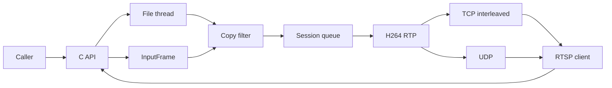
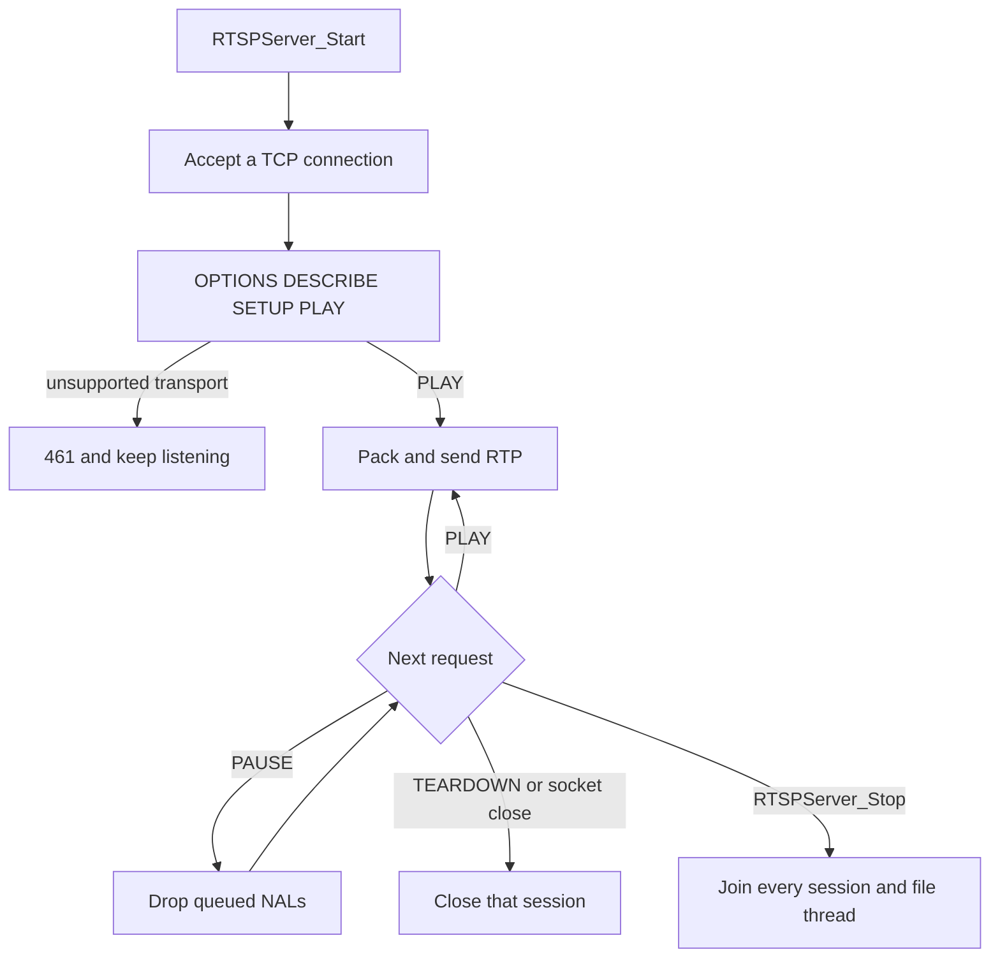
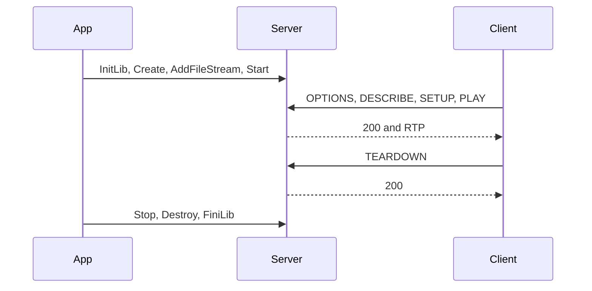

[中文](docs/README.zh-CN.md)

# rtspServer

C library that serves one Annex-B H.264 elementary stream over RTSP. The public header is [`include/rtsp_server.h`](include/rtsp_server.h). Build with `make -C prj_linux`, then run `lib/linux64/demo`.

The tree does not contain a player, a decoder, or a container demuxer.

## What it does

- Listen on one IPv4 TCP port and publish named streams, for example `rtsp://127.0.0.1:8554/live`.
- Read an Annex-B H.264 file in a loop, or accept NAL units from the caller through `RTSPServer_InputFrame`.
- Answer `OPTIONS`, `DESCRIBE`, `SETUP`, `PLAY`, `PAUSE`, `TEARDOWN`, `GET_PARAMETER`, and `HEARTBEAT`.
- Send H.264 RTP. `SETUP` chooses TCP interleaved, unicast UDP, or multicast. Each session has its own sequence number and SSRC.

`SETUP` before `DESCRIBE` is rejected. A transport with `interleaved=` uses the RTSP connection. A unicast `client_port` uses UDP, and the `200` includes `server_port` as an even pair from the pool passed to `RTSPServer_InitLib`. `RTP/AVP;multicast` is sent once per stream to `239.1.1.1`. The even port comes from that same pool, and the `200` is `destination=239.1.1.1;port=<even>-<odd>;ttl=16`. A second multicast viewer of the same stream reuses that address and does not start another sender. About every 5 seconds the sender writes an RTCP sender report to the odd port. `RTP/AVP/TCP` without `interleaved` still gets `461`.

`RTSPServer_InputFrame` copies the NAL and returns. The pointer is only needed for that call. A full per-session queue drops the oldest frame. A NAL larger than 512 KiB is rejected.

A file stream paces one VCL NAL as one access unit. SPS, PPS, and SEI stay with the following VCL and share its 90 kHz timestamp. `PLAY` answers `Range: npt=0.000-` and does not seek. `PAUSE` stops RTP and discards what is already queued.

## Build

Linux with gcc, pthread, and C11 is the build that was run.

```bash
make -C prj_linux PLATFORM=linux64
```

That writes `lib/linux64/librtsps.so` and `lib/linux64/demo`. The demo is linked with `-Wl,-rpath,'$ORIGIN'`, so it finds the library beside itself.

Another program links the same library:

```bash
gcc -std=c11 app.c -Iinclude -Llib/linux64 -lrtsps -pthread
```

The makefiles take `PLATFORM` and `CROSS_COMPILE`. A cross build was not run in this tree:

```bash
make -C prj_linux PLATFORM=aarch64 CROSS_COMPILE=aarch64-linux-gnu-
```

`make -C tests` builds `tests/check`, a host check for NAL splitting, FU-A, and SDP text. That binary is not part of `lib/`.

## Example

The sample is [`demo/linux64/src/main.c`](demo/linux64/src/main.c). It calls `RTSPServer_InitLib`, `RTSPServer_Create`, `RTSPServer_AddFileStream`, and `RTSPServer_Start`, then waits for `SIGINT` or `SIGTERM`.

```bash
lib/linux64/demo 8554 live sample/testsrc_320x240_30s.h264 25
```

[`sample/testsrc_320x240_30s.h264`](sample/testsrc_320x240_30s.h264) is a 30-second Annex-B H.264 file made with ffmpeg `testsrc`: 320x240, 25 fps, no B frames. `InitLib` in the demo uses UDP ports 30000 through 30500. The process prints `rtsp://127.0.0.1:8554/live`.

## How it works

1. `RTSPServer_InitLib` builds the UDP port pool. A second call returns success and leaves the pool as it is.
2. `RTSPServer_Create` reserves a server. `RTSPServer_Start` binds the listen socket and starts one thread per file stream already added.
3. The accept thread starts one thread per connection, up to eight. That thread reads the socket.
4. `DESCRIBE` selects the stream from the first URL path segment and returns SDP. `SETUP` stores the transport. `PLAY` subscribes the session to the stream.
5. The file thread, or `RTSPServer_InputFrame`, pushes each NAL through the copy filter. The filter emits the same NAL to every subscriber.
6. The session thread packs RTP and writes it. TCP uses `$`, channel, and a 16-bit length. UDP uses `sendto` toward the RTSP peer address and the client's RTP port. Multicast uses `sendto` toward `239.1.1.1` and the announced port, and writes RTCP sender reports to the next port.
7. `TEARDOWN` sends `200` and the session thread exits. `RTSPServer_Stop` stops accept, sessions, and file threads. `RTSPServer_Destroy` stops a server that is still running, then frees it. `RTSPServer_FiniLib` destroys any server still alive and frees the port pool.

## Architecture

The library owns the threads. The demo, or another program, only calls the C API. One stream feeds many sessions. Packing and sending stay on the session.



## Pull flow



## Pull sequence

`RTSPServer_Stop` runs on the caller thread. Session threads write the `TEARDOWN` response, then exit. The caller joins them after that.



## Layout

```
include/rtsp_server.h     public C API
src/server.c              listen, accept, server table
src/session.c             RTSP state and per-connection thread
src/rtsp_msg.c            request parse and response text
src/sdp.c                 H.264 SDP
src/stream.c              file loop, InputFrame, subscribers
src/filter.c              copy filter
src/annexb.c              start-code split
src/rtp_h264.c            single NAL and FU-A
src/port_pool.c           UDP server_port pairs
src/Makefile              librtsps.so
prj_linux/Makefile        library, then demo
demo/linux64/src/main.c   file-to-RTSP sample
tests/check.c             host checks for split, FU-A, and SDP
```

## Limits

- Four servers, eight streams per server, eight sessions, and eight subscribers per stream. Each session queue holds 16 NALs.
- A NAL above 512 KiB is dropped. RTP payload is at most 1400 bytes. A larger NAL is sent as FU-A. Payload type is 96 and the clock is 90000.
- The file reader treats one VCL NAL as one frame. A frame made of several slices is paced once per slice.
- IPv4 only. There is no authentication, audio, H.265, or container demux.
- Multicast sends RTCP sender reports. Unicast UDP and TCP interleaved do not. RTCP received on the interleaved odd channel, or on a unicast UDP RTCP socket, is discarded.
- `AddStream` records `fps` and does not pace `InputFrame`. The caller supplies `pts90k`.
- A stream name cannot contain `/` or a space. The path length must fit in 511 bytes.
- `make -C prj_linux` was run for `PLATFORM=linux64` and for `PLATFORM=aarch64`. The aarch64 build sets `CROSS_COMPILE` to the RK3568 gcc prefix used by the VES build. That path is not stored in this repository. `lib/aarch64/demo` is an ARM aarch64 executable. There is no Windows build.
