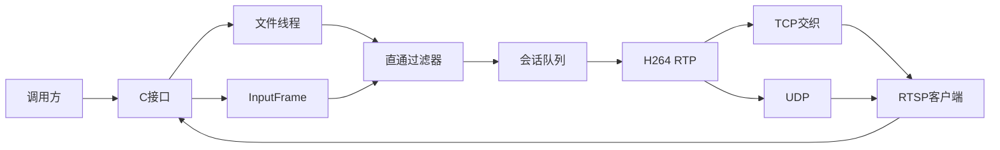
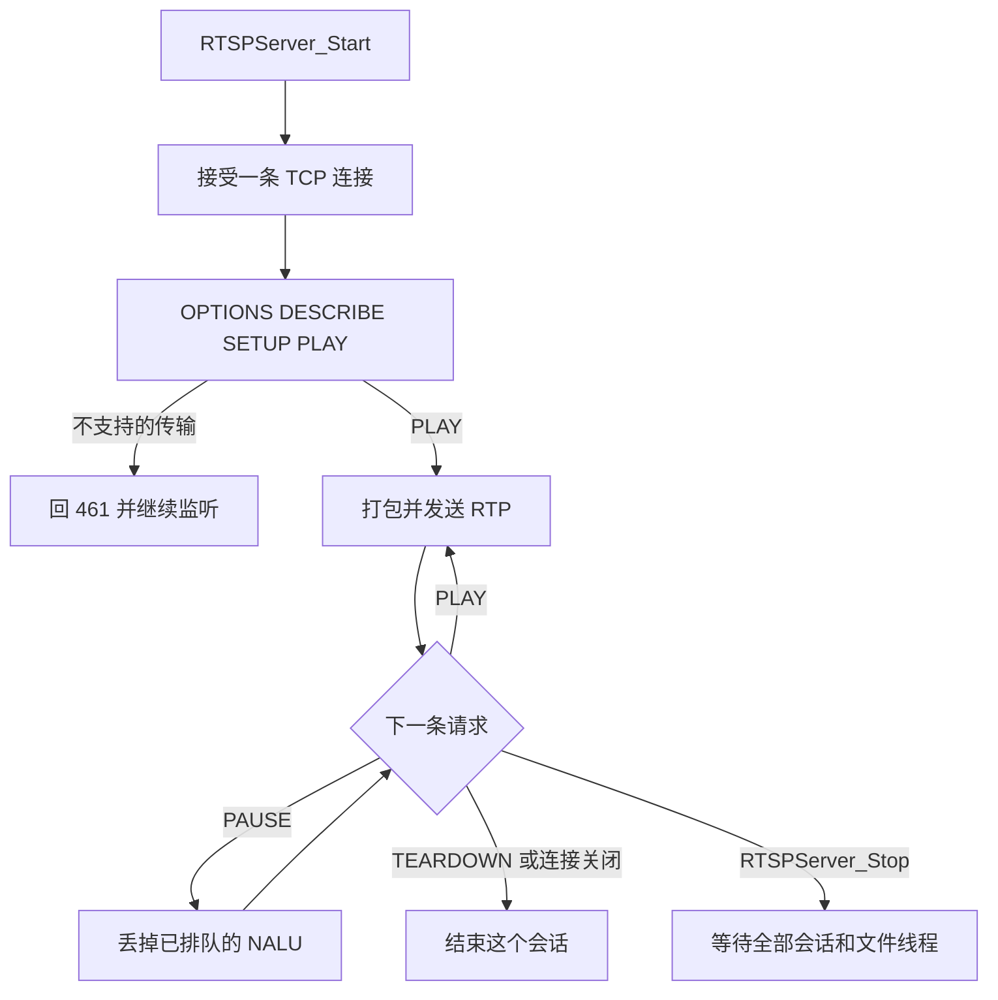
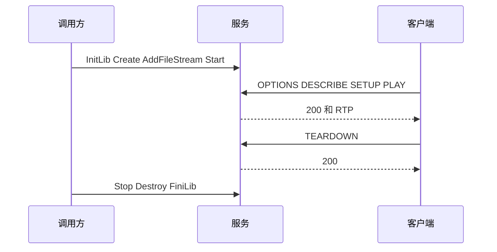

[English](../README.md)

# rtspServer

用 C 写的 RTSP 服务库，把一路 Annex-B H.264 裸流发出去。公开头文件是 [`include/rtsp_server.h`](../include/rtsp_server.h)。在仓库根目录执行 `make -C prj_linux`，再运行 `lib/linux64/demo`。

这个仓库没有播放器、解码器，也不解封装容器。

## 能做什么

- 在一个 IPv4 TCP 端口上监听，按名字发布流，例如 `rtsp://127.0.0.1:8554/live`。
- 循环读取 Annex-B H.264 文件，或者由调用方通过 `RTSPServer_InputFrame` 送入 NALU。
- 应答 `OPTIONS`、`DESCRIBE`、`SETUP`、`PLAY`、`PAUSE`、`TEARDOWN`、`GET_PARAMETER` 和 `HEARTBEAT`。
- 发送 H.264 RTP。`SETUP` 选择 TCP 交织或 UDP。每个会话有自己的序号和 SSRC。

`DESCRIBE` 之前的 `SETUP` 会被拒绝。传输头里有 `interleaved=` 时，RTP 走这条 RTSP 连接。单播 `client_port` 走 UDP，`200` 里的 `server_port` 是 `RTSPServer_InitLib` 端口池中的一对偶数端口。组播，以及没有 `interleaved` 的 `RTP/AVP/TCP`，应答 `461`。

`RTSPServer_InputFrame` 把 NALU 拷进队列后返回。调用方的指针只在这次调用期间被读取。某个会话的队列满了，就丢掉最旧的一帧。超过 512 KiB 的 NALU 直接拒绝。

文件流把一个 VCL NALU 当作一个访问单元来节拍。SPS、PPS 和 SEI 跟在后面的 VCL 上，共用它的 90 kHz 时间戳。`PLAY` 应答 `Range: npt=0.000-`，不定位。`PAUSE` 停止 RTP，并丢掉已经排队的 NALU。

## 构建

实际编过的是带 gcc、pthread 和 C11 的 Linux。

```bash
make -C prj_linux PLATFORM=linux64
```

产物是 `lib/linux64/librtsps.so` 和 `lib/linux64/demo`。demo 使用 `-Wl,-rpath,'$ORIGIN'`，所以它会加载旁边的动态库。

别的程序这样链：

```bash
gcc -std=c11 app.c -Iinclude -Llib/linux64 -lrtsps -pthread
```

Makefile 接受 `PLATFORM` 和 `CROSS_COMPILE`。这条交叉编译没有在本仓库里跑过：

```bash
make -C prj_linux PLATFORM=aarch64 CROSS_COMPILE=aarch64-linux-gnu-
```

`make -C tests` 编出 `tests/check`，在本机检查 NALU 切分、FU-A 和 SDP 文本。这个程序不进 `lib/`。

## 示例

示例是 [`demo/linux64/src/main.c`](../demo/linux64/src/main.c)。它调用 `RTSPServer_InitLib`、`RTSPServer_Create`、`RTSPServer_AddFileStream` 和 `RTSPServer_Start`，然后等到 `SIGINT` 或 `SIGTERM`。

```bash
lib/linux64/demo 8554 live sample/testsrc_320x240_30s.h264 25
```

[`sample/testsrc_320x240_30s.h264`](../sample/testsrc_320x240_30s.h264) 是一份 30 秒的 Annex-B H.264，用 ffmpeg 的 `testsrc` 编成：320x240、25 fps、没有 B 帧。示例里的 `InitLib` 使用 UDP 端口 30000 到 30500。进程会打印 `rtsp://127.0.0.1:8554/live`。

## 实现原理

1. `RTSPServer_InitLib` 建立 UDP 端口池。再次调用返回成功，不重建这个池。
2. `RTSPServer_Create` 占一台服务。`RTSPServer_Start` 绑定监听套接字，并为当时已经挂上的每个文件流起一个线程。
3. accept 线程为每条连接起一个线程，最多八条。读套接字的是这条线程。
4. `DESCRIBE` 用 URL 路径的第一段选定流，并返回 SDP。`SETUP` 记下传输方式。`PLAY` 让这个会话订阅该流。
5. 文件线程或 `RTSPServer_InputFrame` 把每个 NALU 送进直通过滤器。过滤器把同一个 NALU 交给所有订阅者。
6. 会话线程打包 RTP 并写出。TCP 的形式是 `$`、通道号和 16 位长度。UDP 用 `sendto` 发到 RTSP 对端地址和客户端的 RTP 端口。
7. `TEARDOWN` 先回 `200`，然后会话线程退出。`RTSPServer_Stop` 停掉 accept、全部会话和文件线程。`RTSPServer_Destroy` 会先停掉仍在监听的服务，再释放它。`RTSPServer_FiniLib` 销毁还活着的服务，并释放端口池。

## 架构

线程都在库里。demo 或其他程序只调用 C 接口。一路流可以供给多个会话。打包和发送留在会话上。



## 拉流流程



## 拉流时序

`RTSPServer_Stop` 在调用方线程上执行。会话线程写出 `TEARDOWN` 的 `200` 后退出。调用方再等待这些线程。



## 代码结构

```
include/rtsp_server.h     公开的 C 接口
src/server.c              监听、accept、服务表
src/session.c             RTSP 状态和每条连接的线程
src/rtsp_msg.c            请求解析和应答文本
src/sdp.c                 H.264 SDP
src/stream.c              文件循环、InputFrame、订阅者
src/filter.c              直通过滤器
src/annexb.c              按起始码切分
src/rtp_h264.c            单 NALU 和 FU-A
src/port_pool.c           UDP 的 server_port 对
src/Makefile              librtsps.so
prj_linux/Makefile        先编库，再编 demo
demo/linux64/src/main.c   把文件送成 RTSP 的示例
tests/check.c             本机检查切分、FU-A 和 SDP
```

## 边界

- 最多四台服务。每台八路流、八条会话。每路流八个订阅者。每个会话队列放 16 个 NALU。
- 超过 512 KiB 的 NALU 被丢掉。RTP 载荷最多 1400 字节，更大的 NALU 用 FU-A。负载类型是 96，时钟是 90000。
- 文件读取把一个 VCL NALU 当成一帧。一帧里有多个 slice 时，每个 slice 都会占一次节拍。
- 只有 IPv4。没有鉴权、音频、H.265，也不解封装容器。
- 不发送 RTCP SR。交织通道上的奇数通道，以及 UDP 的 RTCP 套接字，收到的数据被丢掉。
- `AddStream` 只记下 `fps`，不会给 `InputFrame` 节拍。时间戳用调用方传入的 `pts90k`。
- 流名字不能含有 `/` 或空格。文件路径要放进 511 字节。
- `make -C prj_linux` 在 `PLATFORM=linux64` 和 `PLATFORM=aarch64` 上都跑过。aarch64 这次把 `CROSS_COMPILE` 设成 VES 构建所用的 RK3568 gcc 前缀。这条路径不在本仓库里。`lib/aarch64/demo` 是 ARM aarch64 可执行文件。没有 Windows 构建。
